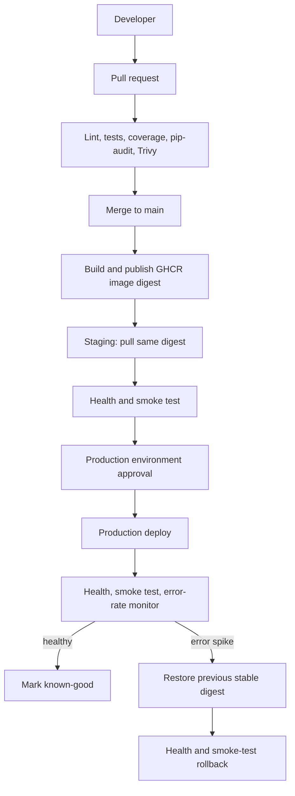

# Production-Grade CI/CD Pipeline with Automated Rollback

TaskFlow is a FastAPI task-management API packaged with a practical CI/CD pipeline: pull-request checks, immutable GHCR images, staging validation, production approval, health/metrics monitoring, and automatic rollback.

> **Scope:** This repository is a runnable local/VM Docker Compose demonstration, not a highly available cloud production system. Its digest-based artifacts, health gates, release state, and rollback contract are designed to migrate to cloud deployment controllers.

## Architecture



## Stack

- Python 3.12, FastAPI, SQLAlchemy, SQLite
- Pytest/HTTPX, Ruff, Black, MyPy, pip-audit
- Docker/Compose, GitHub Actions, GHCR, Trivy
- Prometheus text-format metrics plus executable health, smoke, monitoring, deploy, and rollback scripts

## Run locally

```bash
python -m venv .venv
# Windows PowerShell: .venv\Scripts\Activate.ps1
pip install -r requirements-dev.txt
uvicorn app.main:app --reload
pytest --cov=app --cov-report=term-missing
```

Open `http://localhost:8000/docs`, then call `/health`, `/metrics`, and the `/api/tasks` CRUD endpoints. Containerized local development:

```bash
docker compose up --build
python scripts/smoke_test.py --base-url http://localhost:8000
```

The local Compose image is built locally by design. Staging and production only accept `image@sha256:...` references from GHCR and never build on the target host.

## Pipeline flow

1. Every pull request to `main` runs Ruff, Black, MyPy, tests with an 80% coverage floor, pip-audit, a Docker build, and Trivy filesystem/image scans.
2. A successful `main` build repeats the gates, publishes SHA and `latest` tags to GHCR, then passes the actual image digest to staging.
3. Staging runs on a `self-hosted, staging` runner and pulls that exact digest. It must pass `/health` and the smoke test.
4. Production is a manual workflow targeting the protected `production` GitHub Environment. Required reviewers block the job before deployment commands run.
5. Production records the old digest, deploys the new one, validates it, waits an observation window, then calculates `5xx / total requests * 100` from `/metrics`.
6. A passing release becomes `stable-image`; a failure restores `previous-stable-image` and verifies the rollback. No predecessor is treated as a loud failure, not a silent no-op.

## GitHub configuration

Create `staging` and `production` Environments. In **Settings → Environments → production**, enable **Required reviewers**. Protect `main`: require pull requests, review approval, and the `Pull request validation` check; restrict direct pushes.

Install a self-hosted GitHub Actions runner on each isolated Docker host/VM, label one `staging` and one `production`, install Docker Engine + Compose and Python 3, and grant the runner account Docker access. Give both runners read access to the GHCR package. CI uses the short-lived `GITHUB_TOKEN` to publish.

`SLACK_WEBHOOK_URL` is an optional repository/environment secret. Notifications are skipped safely if it is absent. Do not store credentials, tokens, or webhook URLs in this repository.

## Demonstrate rollback safely

1. Deploy a healthy production digest first; this creates a rollback target.
2. Run **Deploy production** using another staging-verified digest with **simulate_failure** checked.
3. The workflow enables only `/api/demo/failure`, creates 20 bounded controlled 500 responses, and evaluates the configured 5% threshold.
4. The monitor triggers the real Compose rollback script, restores the former digest, and verifies health plus smoke tests.

This controlled mechanism does not crash the process or alter task data.

## Configuration

| Setting | Default | Role |
| --- | --- | --- |
| `DATABASE_URL` | `sqlite:///./taskflow.db` | SQLAlchemy data source |
| `APP_VERSION` | `1.0.0` | Health/metrics release version |
| `SIMULATE_FAILURE` | `false` | Enables only the demo failure endpoint |
| `ROLLBACK_ERROR_RATE_THRESHOLD` | `5` | Rollback trigger percentage |
| `ROLLBACK_WINDOW_SECONDS` | `60` | Monitoring delay |
| `HEALTH_TIMEOUT_SECONDS` | `60` | Deployment health deadline |

See [ARCHITECTURE.md](ARCHITECTURE.md), [DEPLOYMENT.md](DEPLOYMENT.md), [SECURITY.md](SECURITY.md), and [CONTRIBUTING.md](CONTRIBUTING.md).

## Interview explanation

“I treated the image digest as the release artifact. PRs run quality, test, coverage, dependency, filesystem, and image security gates. Main publishes to GHCR only after those gates pass, and staging pulls that same digest. Production is a protected GitHub Environment, so a reviewer explicitly approves it. The deployment retains the previous stable digest, observes health and a 5xx-rate signal, then rolls back and validates the restore if the threshold is breached.”

Key points: image tags are discoverable but digests are immutable; health checks alone are insufficient so the pipeline adds smoke tests and an error-rate SLO signal; this single-host Compose state is a demonstrator, while Kubernetes/ECS rollout controllers provide true blue/green or canary traffic shifting in cloud production.
